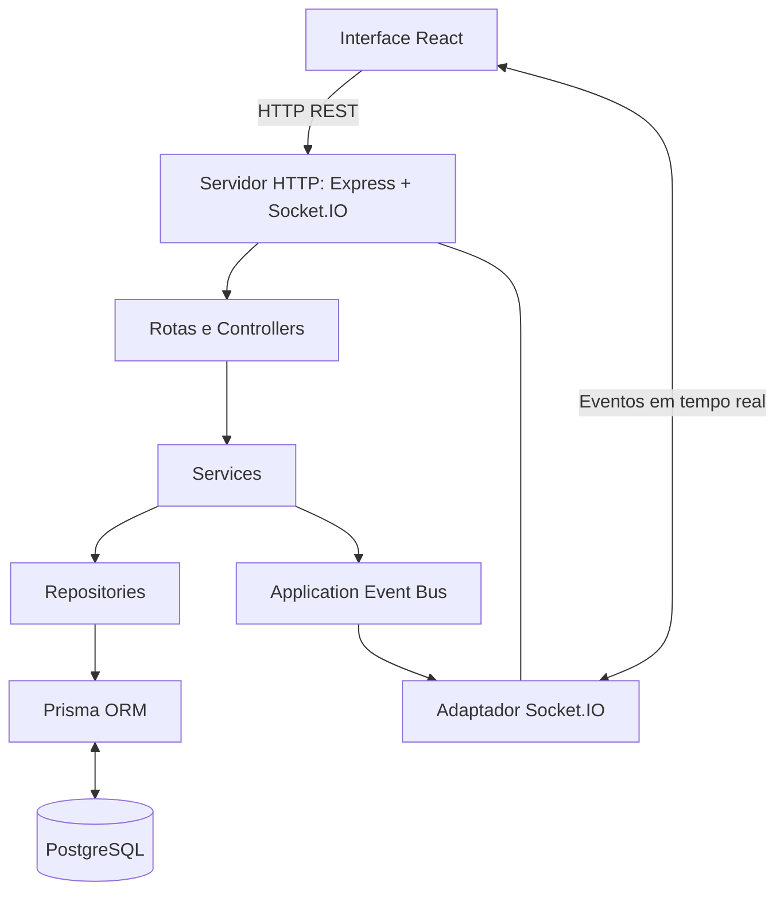
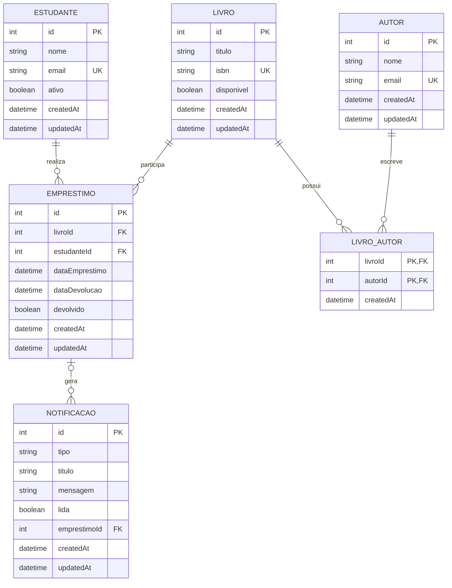

# ARQUITETURA.md — Biblioteca em Tempo Real

## 1. Contexto e domínio

Aplicação educacional para acompanhar o acervo e as movimentações de uma biblioteca. O Trabalho 4 evolui a API do Trabalho 3, acrescentando uma interface React, eventos Socket.IO e uma central de notificações persistida. Um empréstimo ou uma devolução atualiza o banco, cria uma notificação e publica eventos para os clientes conectados.

## 2. Camadas e fluxo

```text
React (frontend/dist)
   │ HTTP REST + Socket.IO
   ▼
Servidor HTTP (Express + Socket.IO)
   ├── Routes → Controllers → Services → Repositories → Prisma ORM → PostgreSQL
   └── Socket.IO adapter ← Application Event Bus ← Services
```

- **Routes/Controllers:** adaptam parâmetros HTTP e respostas; validam entrada.
- **Services:** coordenam casos de uso, mantêm regras e publicam eventos de aplicação.
- **Repositories:** isolam acesso ao Prisma e consultas persistidas.
- **Application Event Bus:** abstração de eventos para que as regras de aplicação não dependam diretamente do Socket.IO.
- **Socket.IO adapter:** gerencia conexões/salas, valida payloads e distribui eventos aos clientes.
- **React:** consulta a API e mantém a tela sincronizada com eventos do servidor.

## 3. Padrões de projeto aplicados

1. **Repository:** `livroRepository`, `emprestimoRepository` e demais repositórios isolam persistência das regras de negócio.
2. **Service Layer:** classes de serviço centralizam os casos de uso de livro, estudante, autor, empréstimo e notificação.
3. **Dependency Injection:** `src/config/container.js` injeta os repositórios e o barramento de eventos nos serviços/controladores.
4. **Observer / Publish–Subscribe:** `eventBus` publica eventos de aplicação; o adaptador Socket.IO escuta esses eventos e propaga atualizações às salas, reduzindo acoplamento.

## 4. Persistência e integridade

PostgreSQL é executado como serviço `db` no Compose. Prisma ORM mantém migrations versionadas. As tabelas são `Estudante`, `Livro`, `Autor`, `LivroAutor`, `Emprestimo` e `Notificacao`. As relações de livro/autores e empréstimo/livro/estudante permanecem. `Notificacao.emprestimoId` é opcional e usa `SET NULL` quando um empréstimo relacionado é excluído.

O cadastro de empréstimo e a devolução continuam usando transações em `emprestimoRepository.js`, atualizando o estado do livro no mesmo limite transacional. O seed usa `upsert` e não apaga os dados existentes durante a reinicialização.

## 5. Salas Socket.IO

- `biblioteca:geral`: sala padrão para eventos gerais e indicadores.
- `emprestimos`: alterações de empréstimos.
- `notificacoes`: central de alertas.
- `livro:{id}`: acompanhamento da disponibilidade de um livro específico.

### Eventos enviados pelo cliente para o servidor

| Evento | Payload | Resultado |
|---|---|---|
| `sala:entrar` | `{ "sala": "emprestimos" }`, `{ "sala": "notificacoes" }`, `{ "sala": "biblioteca" }` ou `{ "sala": "livro", "livroId": 1 }` | Entra numa sala permitida; responde por ACK e emite `sala:entrou`. |
| `sala:sair` | Mesmo formato de `sala:entrar`, exceto a sala geral | Sai de uma sala opcional. |
| `painel:solicitar` | `{}` | Recebe snapshot de indicadores por `painel:atualizado`. |
| `notificacoes:sincronizar` | `{ "limite": 20 }` (1–50) | Recebe histórico via `notificacoes:sincronizadas`. |
| `notificacao:marcar-lida` | `{ "id": 1 }` | Persiste a leitura e emite `notificacao:lida`. |

### Eventos enviados pelo servidor

| Evento | Quando ocorre |
|---|---|
| `conexao:estado` | Conexão estabelecida/reestabelecida. |
| `sala:entrou`, `sala:saiu` | Mudança de sala solicitada. |
| `participantes:atualizados` | Cliente entra ou sai de uma sala. |
| `emprestimo:criado` | Um novo empréstimo foi salvo. |
| `emprestimo:devolvido` | Uma devolução foi salva. |
| `emprestimo:atualizado`, `emprestimo:excluido` | Um empréstimo mudou ou foi removido. |
| `livro:disponibilidade` | Disponibilidade do livro mudou. |
| `notificacao:nova` | Nova notificação persistida. |
| `notificacao:lida`, `notificacao:lidas-todas` | Uma ou todas as notificações foram marcadas como lidas. |
| `painel:atualizado` | Snapshot com contagens sincronizadas. |
| `socket:erro` | Payload inválido ou operação websocket não permitida. |

Mensagens recebidas são validadas no servidor: tipos de payload, sala, ID inteiro positivo e limites de paginação. A conexão utiliza a reconexão do Socket.IO; ao reconectar, a interface volta a entrar nas salas e solicita um snapshot atualizado.

## 6. Saúde, ambiente e encerramento

- `GET /health` verifica a conexão com o banco e é usado pelo HEALTHCHECK.
- `/docs` disponibiliza a interface Swagger UI baseada em `src/docs/openapi.yaml`.
- O Docker Compose aguarda o banco ficar saudável antes de iniciar a aplicação.
- `docker-entrypoint.sh` executa `prisma migrate deploy` e o seed idempotente antes de iniciar o servidor.
- `SIGTERM`/`SIGINT` fecha Socket.IO/HTTP e desconecta Prisma.
- Variáveis e credenciais de desenvolvimento ficam em `.env`; apenas `.env.example` é versionado.

## 7. Diagrama de arquitetura



## 8. Diagrama de entidades e relacionamentos (ER)



O campo `Notificacao.emprestimoId` é opcional. Uma notificação pode permanecer registrada mesmo sem um empréstimo associado.
