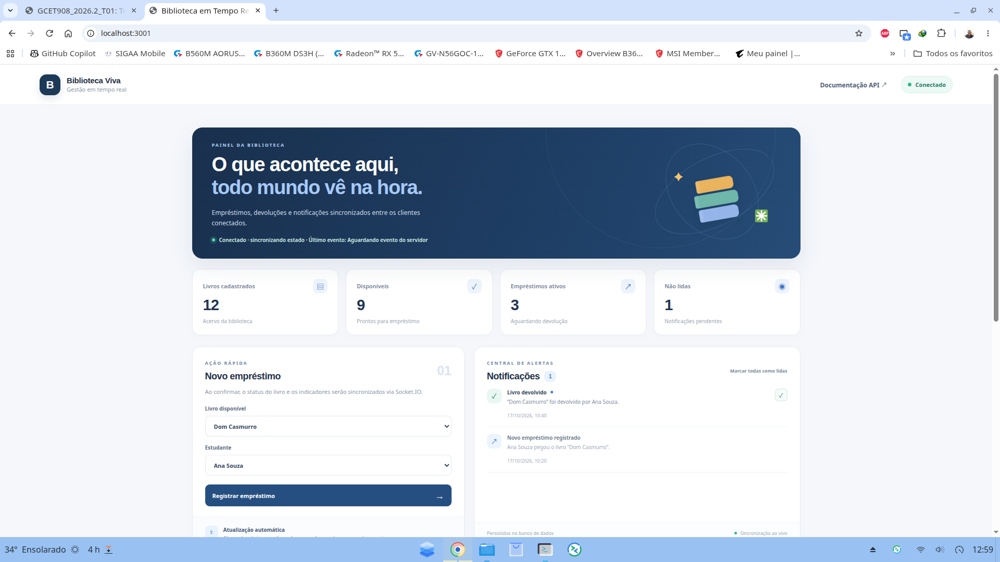
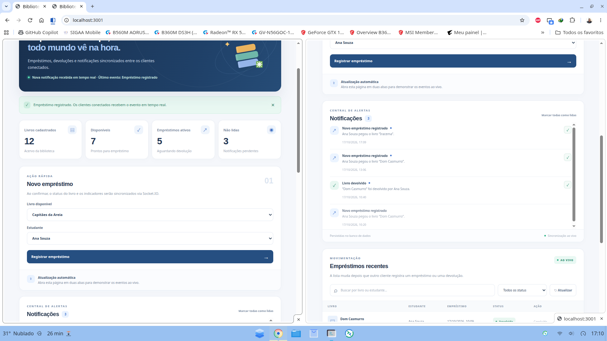
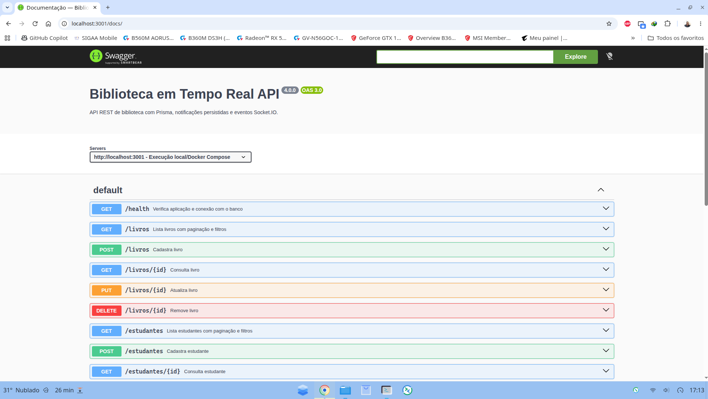
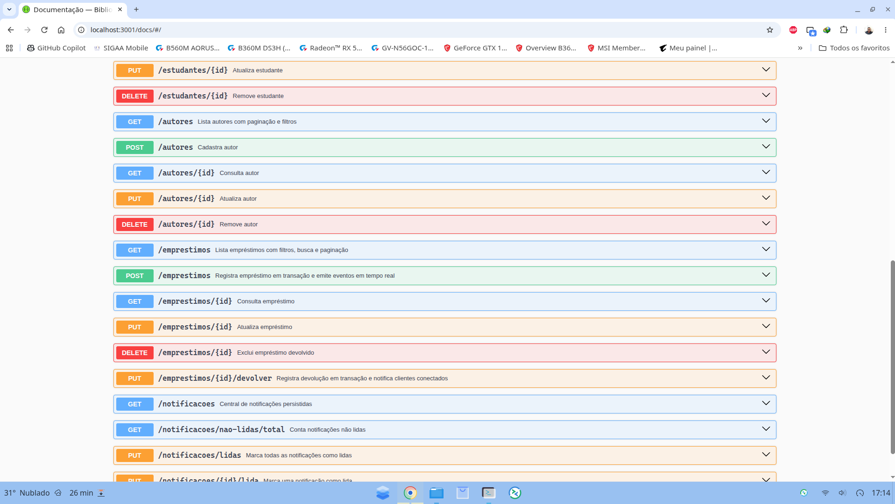
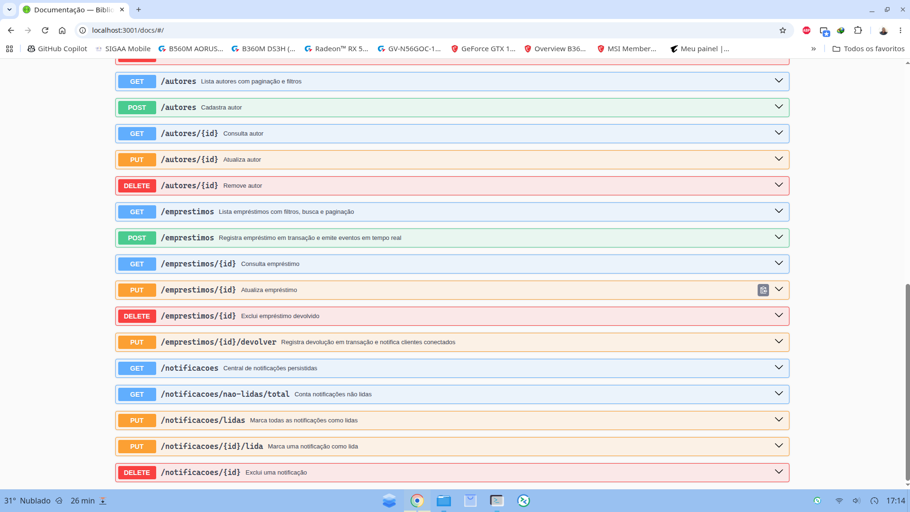

# Biblioteca em Tempo Real — Trabalho 4

**Universidade:** UFRB — Universidade Federal do Recôncavo da Bahia
**Polo:** Feira de Santana — BA
**Curso:** Licenciatura em Computação — 4º semestre
**Disciplina:** Desenvolvimento de Software II
**Docente:** Tassio Valle
**Discente:** Leandro Oliveira Lima

## 1. Descrição

Evolução da API de biblioteca do Trabalho 3 para um sistema de acompanhamento com notificações ao vivo. A aplicação oferece cadastro e consulta de livros, estudantes, autores e empréstimos; registra notificações de empréstimos e devoluções; apresenta indicadores e uma central de alertas que se atualizam em tempo real por Socket.IO.

A proposta se enquadra na **Opção 3 — Sistema de Acompanhamento com Notificações ao Vivo**, usando o domínio educacional de empréstimos de biblioteca descrito no enunciado do Trabalho 4.

## 2. Tecnologias

- Node.js 22, Express 5 e Socket.IO 4
- React 19 e Vite
- Prisma ORM 7 e PostgreSQL 16
- Docker e Docker Compose
- Swagger UI / OpenAPI 3.0
- Testes automatizados com `node:test` e cliente Socket.IO

## 3. Subir com Docker Compose

Requisitos: Docker Engine e Docker Compose plugin instalados.

```bash
cp .env.example .env
docker compose up -d --build
```

A primeira inicialização cria o banco PostgreSQL, aplica as migrations e executa o seed idempotente automaticamente. A aplicação e o banco possuem health checks.

Acesse:

- Interface: http://localhost:3001
- Documentação OpenAPI: http://localhost:3001/docs
- Health check: http://localhost:3001/health
- Documento OpenAPI em JSON: http://localhost:3001/openapi.json

Para acompanhar os serviços:

```bash
docker compose ps
docker compose logs -f app
```

Para parar a aplicação sem apagar os dados:

```bash
docker compose down
```

Para apagar os volumes de dados também (atenção: isso exclui o banco salvo):

```bash
docker compose down -v
```

## 4. Migrations e seed dentro do container

O entrypoint executa migration e seed na inicialização, mas também é possível executar os comandos manualmente:

```bash
docker compose exec app npx prisma migrate deploy
docker compose exec app npx prisma db seed
```

O seed é idempotente: ele acrescenta os dados de demonstração que estiverem faltando, sem limpar as tabelas.

## 5. Execução para desenvolvimento local

A forma recomendada para a avaliação é o Docker Compose. Para desenvolvimento, instale as dependências:

```bash
npm install
cp .env.example .env
```

O valor `DATABASE_URL` do exemplo usa `db`, que é o hostname dentro da rede Docker. Para executar o Node fora do Docker, é necessário ter PostgreSQL local acessível e ajustar `DATABASE_URL` para `localhost` e a porta correta.

```bash
npx prisma generate
npx prisma migrate deploy
npx prisma db seed
npm run build
npm start
```

Para desenvolver em dois terminais, use `npm run dev` para a API/Socket.IO e `npm run dev:frontend` para a interface Vite. O proxy do Vite redireciona as rotas REST e o Socket.IO para `localhost:3001`. Ao executar a interface pelo Vite, abra `http://localhost:5173`.

## 6. API REST

Os recursos existentes do Trabalho 3 continuam nas rotas originais:

- `/livros` — GET, POST, GET/PUT/DELETE `/:id`
- `/estudantes` — GET, POST, GET/PUT/DELETE `/:id`
- `/autores` — GET, POST, GET/PUT/DELETE `/:id`
- `/emprestimos` — GET, POST, GET/PUT/DELETE `/:id`, PUT `/:id/devolver`
- `/notificacoes` — listagem com filtros, marcar uma/todas como lidas e remover

As listagens usam paginação e filtros. Os detalhes dos parâmetros e respostas estão em `/docs`. Erros são respondidos em JSON com mensagens padronizadas pelo middleware existente.

## 7. Comunicação em tempo real

A aplicação integra Socket.IO ao mesmo servidor HTTP e porta da API e do front-end. As mensagens de entrada são validadas pelo servidor e as atualizações são segmentadas por salas:

- `biblioteca:geral`
- `emprestimos`
- `notificacoes`
- `livro:{id}`

A lista de eventos e os payloads estão documentados em [ARQUITETURA.md](./ARQUITETURA.md).

## 8. Como demonstrar a sincronização

1. Abra http://localhost:3001 em duas abas ou em dois navegadores.
2. Confirme que ambos indicam “Conectado”.
3. Em uma aba, registre um empréstimo de um livro disponível.
4. Observe na outra aba a lista, os indicadores e a notificação atualizados sem recarregar.
5. Registre a devolução e confirme que a disponibilidade do livro e a central de notificações mudam nos dois clientes.
6. Marque uma notificação como lida; o estado fica persistido após recarregar a página.
7. Abra `/docs` para demonstrar o contrato REST e `/health` para demonstrar a saúde da aplicação.

## 9. Arquitetura e padrões

A arquitetura utiliza Routes, Controllers, Services, Repositories, Prisma ORM e um adaptador Socket.IO separado pelo barramento de eventos da aplicação. Foram aplicados e justificados os padrões Repository, Service Layer, Dependency Injection e Observer/Publish–Subscribe. Ver [ARQUITETURA.md](./ARQUITETURA.md).

## 10. Testes e qualidade

```bash
npm test
npm run lint
npm run build
```

Os testes de Socket.IO cobrem entrada em salas, rejeição de salas/payloads inválidos e sincronização do painel. O workflow GitHub Actions executa os testes, lint, build da interface e build Docker em `push`/`pull_request`.

## 11. Configuração e segurança

Copie `.env.example` para `.env`. Não comite `.env`, tokens, senhas reais ou outros segredos. As credenciais no exemplo são exclusivamente para a execução local de demonstração e devem ser substituídas fora desse contexto.

## 12. Evidências visuais

As capturas reais da execução estão inseridas na seção 14 deste README e armazenadas em `docs/capturas/`. O arquivo `docs/capturas/README.md` descreve a finalidade das evidências.

## 13. Catálogo de eventos Socket.IO e payloads

O cliente conecta-se ao mesmo servidor HTTP da API. Ao conectar, entra automaticamente na sala `biblioteca:geral`. O servidor valida os eventos recebidos e responde por ACK quando fornecido pelo cliente.

### Eventos enviados pelo cliente

| Evento | Payload | Resposta ou comportamento |
|---|---|---|
| `sala:entrar` | `{"sala":"biblioteca"}`, `{"sala":"emprestimos"}`, `{"sala":"notificacoes"}` ou `{"sala":"livro","livroId":1}` | Entra na sala permitida; emite `sala:entrou` e `participantes:atualizados`. |
| `sala:sair` | Mesmo formato de entrada, exceto `biblioteca` | Sai da sala opcional; emite `sala:saiu` e atualiza participantes. |
| `painel:solicitar` | `{}` ou payload omitido | Responde com `painel:atualizado` contendo indicadores do painel. |
| `notificacoes:sincronizar` | `{"limite":20}` ou payload omitido | Retorna histórico, total e quantidade de não lidas por `notificacoes:sincronizadas`. O limite padrão é 20 e o permitido vai de 1 a 50. |
| `notificacao:marcar-lida` | `{"id":1}` | Persiste a leitura e confirma por ACK; a atualização é publicada em `notificacao:lida`. |

O ID de notificação deve ser um inteiro positivo seguro. Salas ou payloads inválidos são rejeitados. As respostas de erro usam `socket:erro` com o formato `{"ok":false,"erro":"mensagem"}`.

### Eventos emitidos pelo servidor

| Evento | Payload ou conteúdo |
|---|---|
| `conexao:estado` | `{"conectado":true,"socketId":"...","reconectado":false}` |
| `sala:entrou` e `sala:saiu` | `{"ok":true,"sala":"emprestimos","participantes":2}` |
| `participantes:atualizados` | `{"sala":"biblioteca:geral","total":2}`; na desconexão, pode incluir `motivo`. |
| `emprestimo:criado` | Registro do empréstimo criado, incluindo as relações retornadas pelo serviço. |
| `emprestimo:devolvido` | Registro do empréstimo devolvido. |
| `emprestimo:atualizado` | Registro do empréstimo atualizado. |
| `emprestimo:excluido` | `{"id":1}` |
| `livro:disponibilidade` | `{"livroId":1,"disponivel":false,"livro":{...}}` |
| `notificacao:nova` | Registro da notificação persistida, com tipo, título, mensagem e estado de leitura. |
| `notificacao:lida` | Registro da notificação após a atualização do estado de leitura. |
| `notificacao:lidas-todas` | `{"quantidade":3}` |
| `notificacoes:sincronizadas` | `{"notificacoes":[...],"total":10,"naoLidas":2}` |
| `painel:atualizado` | `{"livros":12,"livrosDisponiveis":9,"emprestimosAtivos":3,"emprestimosDevolvidos":2,"notificacoesNaoLidas":1}` |
| `socket:erro` | `{"ok":false,"erro":"Evento não permitido"}` |

Os valores numéricos acima são exemplos ilustrativos dos formatos, não valores fixos. Os eventos de empréstimos são publicados para as salas correspondentes; notificações e indicadores são distribuídos conforme a configuração das salas em `src/adapters/websocket/socketIoServer.js`.

Os eventos `painel:atualizar` e demais eventos publicados pelo `eventBus` são internos da aplicação; não são eventos de entrada enviados diretamente pelos clientes.

## 14. Evidências visuais da aplicação

As capturas abaixo foram registradas durante a execução local do projeto.

### Interface principal



### Sincronização em tempo real entre dois clientes



### Documentação OpenAPI / Swagger






